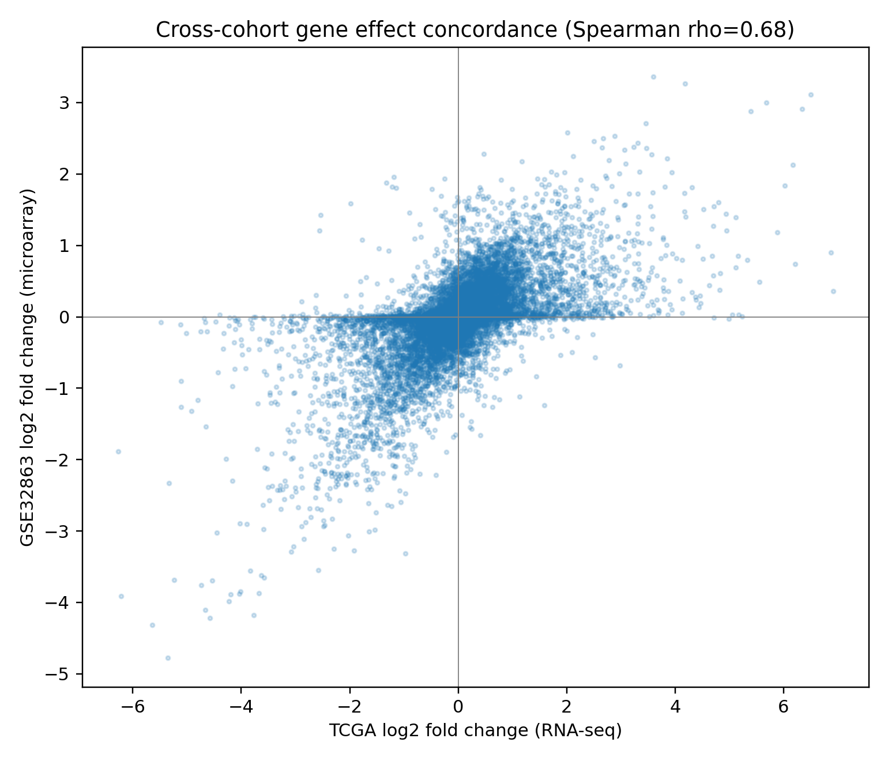
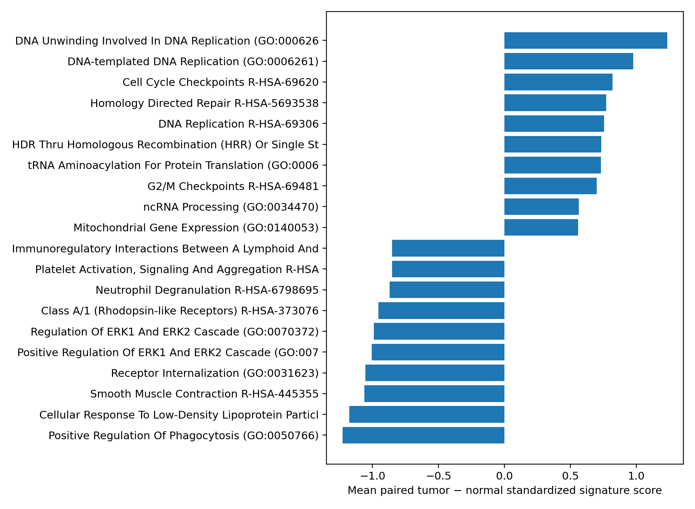

# TCGA-LUAD Transcriptomics: Discovery, Pathway Analysis & External Validation

Reproducible, **exploratory** lung adenocarcinoma transcriptomics research
project using TCGA-LUAD RNA-seq and independent GEO GSE32863 microarray
validation. Includes source code, historical Google Colab notebooks,
publication-oriented figures, a biological interpretation report,
and a release-level consistency audit.



## Key results

| Metric | Observed |
|---|---:|
| Discovery samples | 30 (15 tumors, 15 normals) |
| Site groups | 7 overlapping TSS groups |
| Tested genes | 19,447 |
| Discovery FDR < 0.05 | 8,889 |
| Discovery FDR < 0.05 and abs(log2FC)>1 | 4,469 |
| External complete patient pairs | 57 |
| Genes matched across platforms | 11,431 |
| Discovery hits with external mapping | 2,600 |
| Direction agreement | 2,401/2,600 (92.3%) |
| External FDR < 0.05 and matching direction | 2,061/2,600 (79.3%) |
| Spearman correlation, all matched genes | 0.679 |
| Preselected transferred pathway signatures meeting criteria | 20/20 |

**Interpretation:** Strong cross-cohort consistency in selected
transcriptional patterns. This does **not** demonstrate causal mechanisms,
clinical validity, or independence of overlapping gene sets.

## Highlights

- Tumor-associated cell-cycle and DNA replication transcriptional signatures.
- Extracellular matrix/collagen expression changes.
- Normal-associated lung epithelial and immune/receptor-related signatures.
- Candidate gene validation: COL1A1, COL3A1, MMP1, TOP2A, MKI67,
  AGER, SFTPC, SFTPA1.



## Repository structure

- `notebooks/` — original phase-specific Google Colab notebooks
- `src/` — Python and R source scripts
- `data/metadata/` — public discovery cohort sample metadata
- `results/tables/` — curated analysis outputs
- `results/figures/` — original figures from completed analyses
- `reports/` — Phase 8 biological interpretation PDF
- `scripts/audit_release.py` — automated result consistency checks
- `tests/` — release tests
- `docs/` — data provenance, methods, limitations, reproduction instructions

## Quick verification

```bash
python -m pip install -r requirements.txt
python scripts/audit_release.py
python -m pytest -q tests/test_release.py
```

See [reproduction instructions](docs/REPRODUCE.md) and
[methods/limitations](docs/METHODS_AND_LIMITATIONS.md).

## Sources

- [NCI GDC TCGA-LUAD](https://portal.gdc.cancer.gov/projects/TCGA-LUAD)
- [NCBI GEO GSE32863](https://www.ncbi.nlm.nih.gov/geo/query/acc.cgi?acc=GSE32863)

## Release status

Phase 10 packages and audits **existing completed analyses**.
The historical notebooks have not been converted into a single fully
automated end-to-end workflow, and all stages have not been rerun
in a fresh environment. Leave-one-site-out analysis was omitted.

## License

MIT for original project code; upstream study data retain their
respective source terms. Please cite the original datasets and studies.
